# Assignment 3: Secure File Upload System

## Table of Contents

1. [Introduction](#1-introduction)
2. [Objectives](#2-objectives)
3. [Tools and Technologies](#3-tools-and-technologies)
4. [Implementation and Testing Before Security](#4-implementation-and-testing-before-security)
5. [Security Controls Implemented](#5-security-controls-implemented)
6. [Testing After Security](#6-testing-after-security)
7. [Comparison: Before and After Security](#7-comparison-before-and-after-security)
8. [Limitations](#8-limitations)
9. [Conclusion](#9-conclusion)

---

## 1. Introduction

File upload functionality allows users to send files from their computers to a web server. If the server accepts uploads without checking them, an attacker may upload unwanted file types, oversized files, or files disguised with misleading extensions. Any of these can put both the application and the underlying server at risk.

This assignment develops a simple file upload web application and compares its behaviour **before** and **after** security controls are applied. The vulnerable version is run locally for controlled testing only. The secured version adds:

- file-type (extension) checks,
- MIME-type validation,
- file-signature validation,
- a file-size limit,
- server-generated filenames,
- private storage, and
- controlled error handling.

---

## 2. Objectives

| # | Objective |
|---|-----------|
| 1 | Develop a working file upload feature. |
| 2 | Demonstrate the risks of accepting files without validation. |
| 3 | Implement server-side validation that allows only JPEG, PNG, and PDF files. |
| 4 | Limit uploaded files to a maximum size of 2 MB. |
| 5 | Use randomly generated filenames instead of trusting the original filename for storage. |
| 6 | Store uploaded files outside the public website directory. |
| 7 | Test the vulnerable and secured versions and compare the results. |

---

## 3. Tools and Technologies

| Tool / Technology | Purpose |
|-------------------|---------|
| Windows | Development and testing environment |
| Node.js | JavaScript runtime for the server |
| npm | Installs project dependencies |
| Express | Web server and HTTP routing |
| Multer | Handles `multipart/form-data` file uploads |
| HTML | Provides the upload form |
| Web browser | Tests the upload functionality |
| VS Code / terminal | Edits code and runs the application |

---

## 4. Implementation and Testing Before Security

### 4.1 Install Node.js

Node.js and npm were installed and verified using `node -v` and `npm -v`.

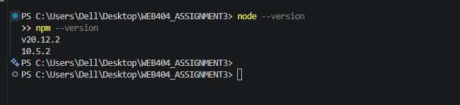

*Evidence 1: Node.js installation and version check*

### 4.2 Create the Project and Install Dependencies

A project folder named `Assignment3-FileUpload` was created. The Node.js project was initialised with `npm init -y`, and Express and Multer were installed with `npm install express multer`.

*Evidence 2: Creating the project folder*

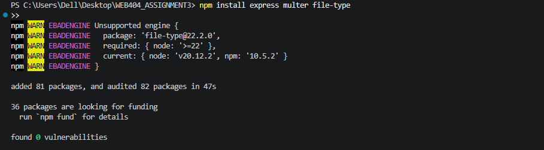

*Evidence 3: Initialising the Node.js project*

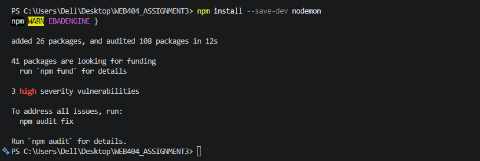

*Evidence 4: Installing Express and Multer*

### 4.3 Create the Project Folders and Files

The project was organised into three parts: a frontend file, a server file, and an upload directory. The frontend file is placed in the `public` directory, while uploaded files are saved in the `uploads` directory.

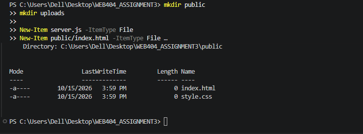

*Evidence 5: Project folders and files*

### 4.4 Create the Frontend Upload Form

The HTML page contains a file selector and an **Upload File** button. The form uses `method="POST"` and `enctype="multipart/form-data"` so that the selected file can be transmitted to the server.

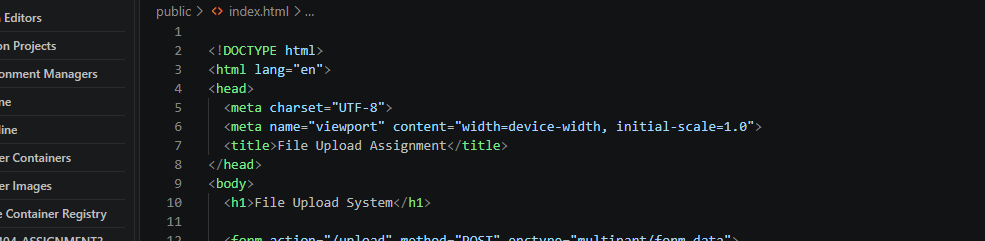

*Evidence 6: Frontend file upload form code*

### 4.5 Create the Vulnerable Backend

The first backend used Express and Multer to receive and save uploaded files. It deliberately **did not** implement:

- an allowlist for file extensions,
- MIME-type validation,
- a file-signature check, or
- an application-defined file-size limit.

It also stored each file under its **original filename**.

These weaknesses mean the server can accept file types the application does not need. This version was run only in a local testing environment.

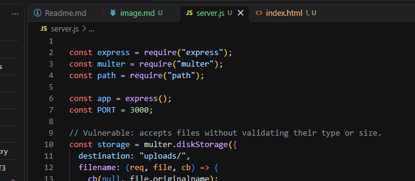

*Evidence 7: Vulnerable backend code*

### 4.6 Run and Open the Vulnerable Application

The application was started with `node app.js` and opened in a browser at `http://localhost:3000`.

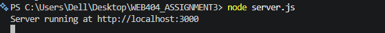

*Evidence 8: Starting the vulnerable server*

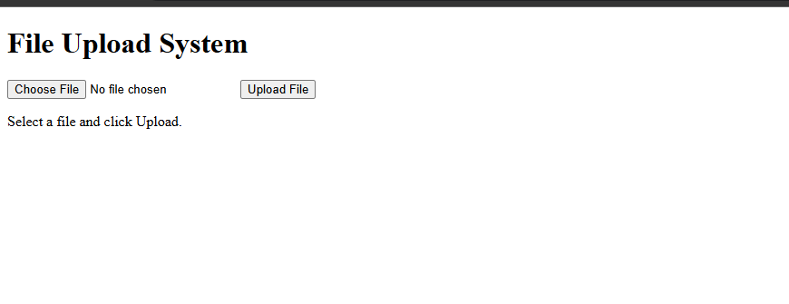

*Evidence 9: Vulnerable upload page in the browser*

A normal file was then selected and uploaded. The server returned an upload success message, and the saved file appeared in the `uploads` directory.

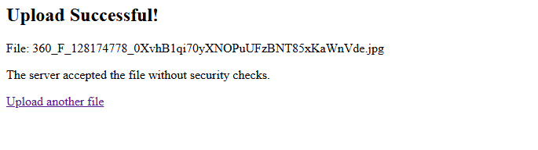

*Evidence 10: Successful upload in the vulnerable version*

### 4.7 Test the Vulnerable Version

Four test files were uploaded to check whether the initial application restricted file types.

> **Note:** The `test.exe` file used here contained **plain text only**. It was not an executable program.

| Test | Observed Result | Security Observation |
|------|-----------------|----------------------|
| Upload `photo.jpg` | Accepted | A normal image was accepted. |
| Upload `document.pdf` | Accepted | A normal PDF was accepted. |
| Upload `test.txt` | Accepted | A file type the application does not require was accepted. |
| Upload `test.exe` (plain text) | Accepted | A file with a disallowed extension was accepted. |

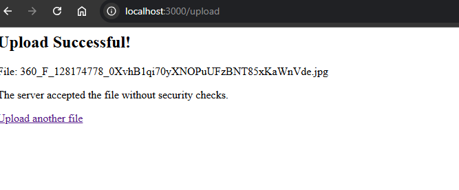

*Evidence 11: Vulnerable version accepting `photo.jpg`*

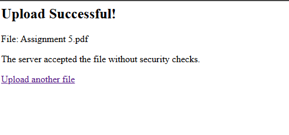

*Evidence 12: Vulnerable version accepting `document.pdf`*

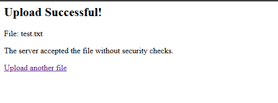

*Evidence 13: Vulnerable version accepting `test.txt`*

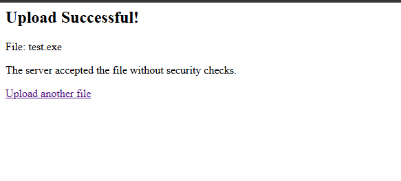

*Evidence 14: Vulnerable version accepting `test.exe`*

**Finding:** The vulnerable version accepted files without enforcing the application's intended file-type policy. This confirms the need for server-side security controls.

---

## 5. Security Controls Implemented

The backend was updated to apply several independent checks before accepting an uploaded file.

| Security Control | Implementation | Purpose |
|------------------|----------------|---------|
| **Extension allowlist** | Allows only `.jpg`, `.jpeg`, `.png`, and `.pdf`. | Rejects file extensions outside the application's requirements. |
| **MIME-type validation** | Compares the declared MIME type with the type expected for the extension. | Rejects uploads whose MIME type does not match the allowlist. |
| **File-signature validation** | Checks the file's leading bytes for the expected JPEG, PNG, or PDF signature. | Detects some files whose contents do not match their claimed type. |
| **File-size limit** | Sets a maximum upload size of 2 MB. | Reduces the risk of oversized uploads consuming server resources. |
| **File-count limit** | Allows one file per upload request. | Restricts the number of files in a single request. |
| **Random server-generated filename** | Uses a randomly generated identifier as the storage name. | Avoids trusting the user-supplied filename and reduces filename collisions. |
| **Private storage** | Stores files in an `uploads` directory outside the public static-file path. | Prevents direct public access through Express static-file serving. |
| **Error handling** | Returns a controlled rejection response when validation fails. | Gives a clear, safe response for invalid and oversized uploads. |

### 5.1 Update the Backend

The vulnerable backend was replaced with a secured implementation. The frontend form was left unchanged, because the important changes belong on the **server**, where checks cannot be bypassed by the client.

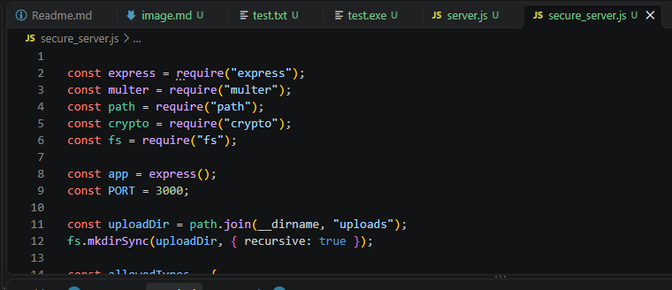

*Evidence 15: Secure backend code*

### 5.2 Restart the Secured Application

The running server was stopped and restarted using the secured backend. The local upload page was then refreshed to test the updated server.

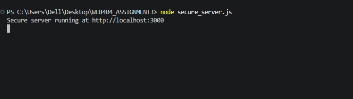

*Evidence 16: Restarting the secured application*

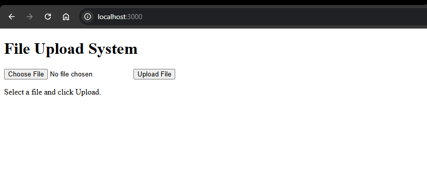

*Evidence 17: Upload page after security controls were implemented*

---

## 6. Testing After Security

The same types of tests were repeated against the secured version, with two additional cases: a mismatched file signature and an oversized file.

| Test | Result | Reason |
|------|--------|--------|
| Valid JPEG or PNG image | Accepted | Extension, MIME type, and checked signature all match an allowed image type. |
| Valid PDF document | Accepted | Extension, MIME type, and checked signature all match the allowed PDF type. |
| `test.txt` | Rejected | The extension is not in the allowlist. |
| `test.exe` (plain text) | Rejected | The extension is not in the allowlist. |
| PNG image renamed to `.jpg` | Rejected | The JPEG signature check fails because the contents are still PNG. |
| File larger than 2 MB | Rejected | The configured upload-size limit is exceeded. |

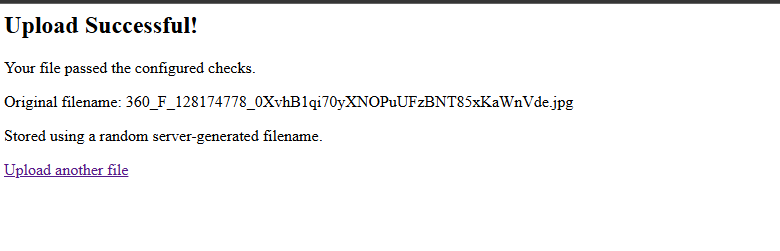

*Evidence 18: Secured version accepting a valid image*

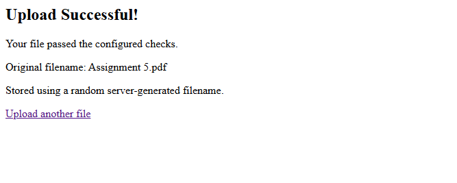

*Evidence 19: Secured version accepting a valid PDF*

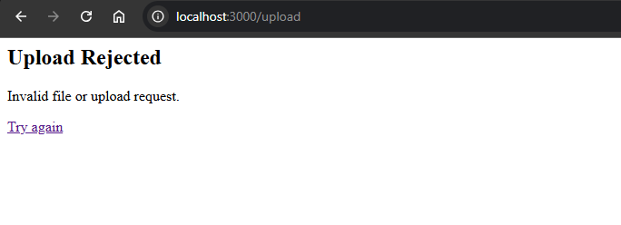

*Evidence 20: Secured version rejecting `test.txt`*

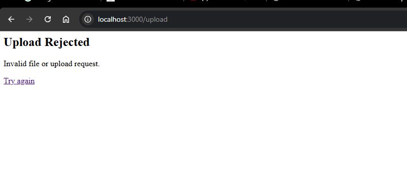

*Evidence 21: Secured version rejecting `test.exe`*

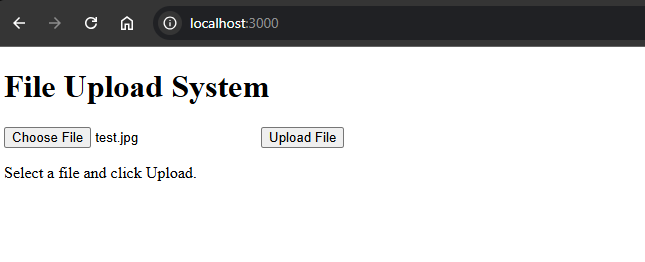

*Evidence 22: Testing a PNG renamed to `.jpg`*

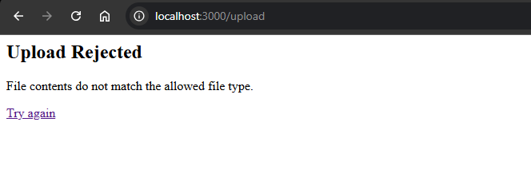

*Evidence 23: Result of the mismatched file-signature test*

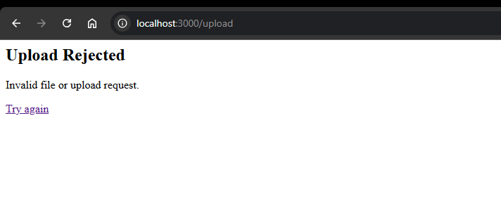

*Evidence 24: Secured version rejecting a file larger than 2 MB*

---

## 7. Comparison: Before and After Security

| Feature | Before Security | After Security |
|---------|-----------------|----------------|
| File-type allowlist | Not implemented | JPEG, PNG, and PDF allowed |
| MIME-type check | Not implemented | Implemented |
| File-signature check | Not implemented | Implemented for supported types |
| Maximum file size | No application-defined limit | 2 MB limit |
| File count per request | Not restricted | One file per request |
| Stored filename | Original filename | Random server-generated filename |
| Upload storage | `uploads` directory | `uploads` directory outside the public path |
| Invalid upload handling | No file validation | Invalid types and oversized uploads rejected |
| Test with `test.txt` | Accepted | Rejected |
| Test with plain-text `test.exe` | Accepted | Rejected |

The comparison shows that the secured version enforces the application's file policy and rejects the test files that the vulnerable version accepted.

---

## 8. Limitations

The implemented checks improve upload security but **do not guarantee** that every accepted file is harmless.

| Limitation | Explanation |
|------------|-------------|
| MIME types can be manipulated | The MIME type is supplied by the client, so MIME checks alone are not reliable. |
| Signature checks are shallow | Only a small part of the file (its leading bytes) is examined. A file may have a valid header and still be malformed or malicious. |
| No malware scanning | The application does not perform malware scanning or deep file-format parsing. |
| Demonstration scope only | The project is a local assignment and does not include production-grade authentication, authorisation, rate limiting, or monitoring. |

**Recommendations for production use:** store uploads in appropriately restricted storage, ensure uploaded content can never be executed, and consider malware scanning and secure file-processing pipelines.

---

## 9. Conclusion

This assignment demonstrated how a basic file upload feature can accept unwanted file types when server-side validation is missing. The vulnerable version accepted `test.txt` and a harmless plain-text file named `test.exe`, illustrating the weakness of unrestricted uploads.

The secured version introduced an extension allowlist, MIME-type checks, file-signature validation, a 2 MB upload limit, a one-file-per-request limit, randomly generated storage names, private storage, and controlled error handling. The tests showed how these controls reject files that do not meet the application's requirements while still allowing supported JPEG, PNG, and PDF files.

Overall, the assignment highlights that file-upload security should rely on **multiple layered server-side controls** rather than trusting the filename, the browser form, or the declared MIME type alone.

