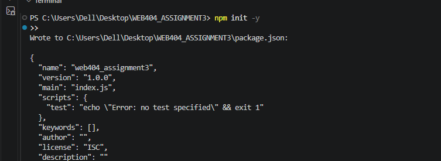

Step 1: Install Node.js

Step 2: Create your project

Step 3: Create the folders and files

Step 4 — Build the file upload feature BEFORE security

4.1 Create the frontend

4.2 Create the vulnerable backend

4.3 Run the vulnerable version

Open your browser and visit:
http://localhost:3000

Select a normal PDF or image, then click Upload File.
You should see the upload success message. Check your uploads folder to confirm that the file was saved.

4.4 Test the weakness
Upload photo.jpg	Accepted

Upload document.pdf	Accepted

Upload test.txt	Accepted

Upload test.exe containing plain text	Accepted

the upload form, a successful upload, and the uploaded test.exe appearing in the uploads folder. These will demonstrate the weakness before security is added.

Step 5 — Implement security AFTER the baseline test

The security measures will be:
Security measure	What it prevents
Extension allowlist	Rejects file names with disallowed extensions
MIME-type validation	Rejects disallowed declared file types
File-signature checks	Detects files whose contents do not match the claimed type
2 MB size limit	Restricts oversized uploads
Random server-generated filenames	Avoids trusting user-supplied filenames
Private storage	Keeps uploads outside the public website directory
Error handling	Returns a controlled response when a file is rejected

We will allow only JPEG, PNG, and PDF files.

5.1 Replace secure_server.js with the secure version

This is a learning implementation of layered upload checks. Signature validation is not a complete malware scanner, and checking only the file header does not prove that an entire file is safe. Production systems may also need deeper parsing, malware scanning, authentication, rate limiting, and isolated storage.

5.2 Restart the application

Refresh the local upload page.

The HTML form can remain unchanged. The difference is now in the server-side validation.

5.3.Test the secure version
Valid JPEG/PNG image	Accepted

Valid PDF document	Accepted

test.txt	Rejected

test.exe containing plain text	Rejected

PNG renamed to .jpg	Rejected if its signature does not match JPEG

File larger than 2 MB	Rejected

	